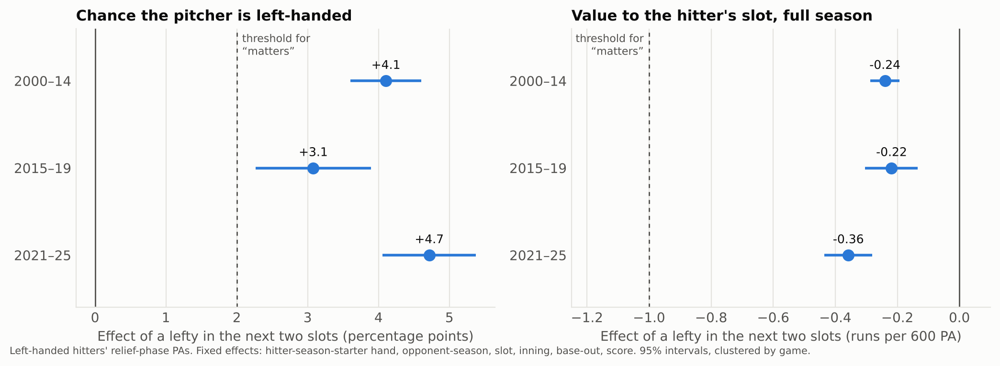
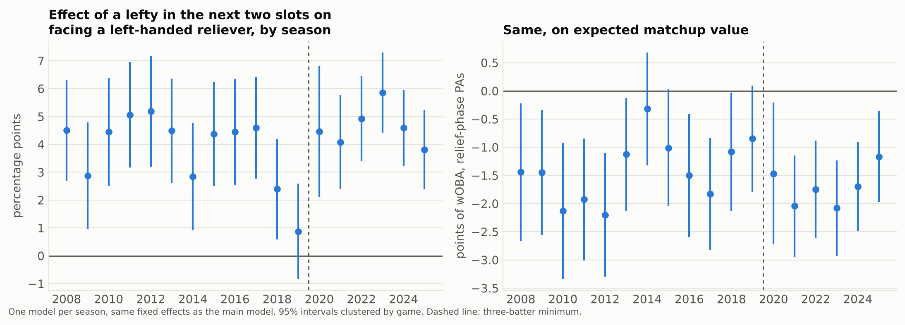
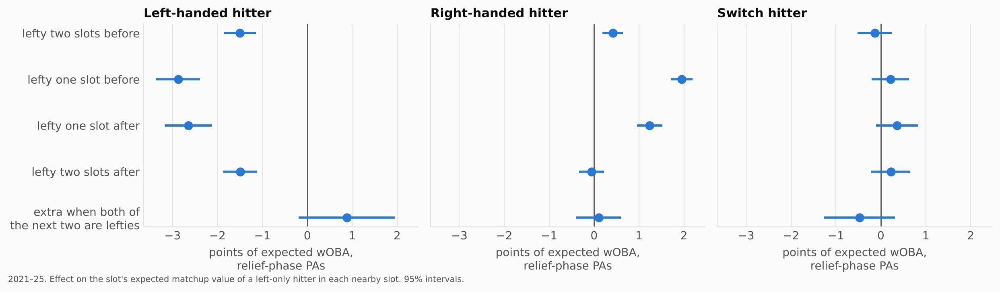

# Do right-handed hitters protect the lefties around them?

**Short answer: yes in how opponents use their bullpen, no in any amount worth
paying for.** A left-handed hitter with a lefty in one of the next two lineup
slots is 4.7 percentage points more likely to face a left-handed reliever than
one followed by two righties. Over a full season that costs him about a third
of a run, or roughly $0.4 million at free-agent prices. That is worth taking
when it is free (the batting order) and not worth a premium when it is not
(an acquisition). The one lineup decision that carries a few runs is not
batting lefties back to back, and every team already avoids it.

Regular seasons 2000–2025, 4.7 million plate appearances, Retrosheet
play-by-play. Design, hypotheses and thresholds were written before the data
were examined ([`DESIGN.md`](DESIGN.md)); changes made afterwards are labelled.

## What a front office should take from this

1. **Don't pay for "lineup balance" as protection.** The effect of neighbors
   on a lefty's matchups is real and precisely measured, and it is worth
   0.36 runs per 600 PA (95% interval 0.28 to 0.43), about $0.4 million a
   season. See [what that is worth](#what-a-third-of-a-run-is-worth) for the
   benchmark.
2. **Do keep lefties apart in the order.** Arrangement matters more than
   count. Three left-handed hitters spread through the order are worth about
   4.6 runs a season more than the same three batted consecutively (interval
   4.0 to 5.2). But this is a mistake nobody makes: in 2025 every one of the
   30 teams' actual lineups beat a random ordering of the same nine hitters,
   by 0.1 to 1.4 runs. There is at most a run or so left to find.
3. **The benefit is mutual, so it is not the righty's to be credited with.**
   A right-handed hitter batting directly behind a lefty sees left-handed
   relievers 6.8 points more often and gains about 0.39 runs per 600 PA. The
   lefty "creates" that as surely as the righty "protects" him. It belongs to
   the pairing.
4. **Who a hitter faces is worth runs, but it comes from how he is used, not
   from who bats near him.** Across 2021–25, a left-handed regular's matchup
   context ranges from about −2.5 to +1.7 runs a season (5th to 95th
   percentile). Platooned lefties are at the top; everyday stars who get every
   lefty specialist are at the bottom. The part traceable to neighbors is
   never more than half a run. When projecting a platoon bat into an everyday
   role, this is the adjustment to make.
5. **A right-handed bench bat is being used more since the three-batter
   rule.** Pinch-hitting for a lefty against a left-handed reliever rose from
   9% of those plate appearances (2015–19) to 15% (2021–25), including for AL
   clubs that always had the DH. The substitution is worth about half a run
   per lineup slot per season, twice what it was.
6. **The opposing bullpen matters more than your own batting order.** Each
   additional left-handed reliever in the other bullpen raises a lefty's
   exposure by 5 points — as much as the neighbor effect — and against a
   bullpen with no lefty the neighbor effect is zero. Still small in runs
   (about 0.4 per lefty hitter per additional lefty reliever, season-long).

## What a third of a run is worth

"Small" needs a benchmark, and the right one depends on what it costs to act.

| | Runs per season | Wins | Approx. value | Range by price tier |
|---|---|---|---|---|
| Neighbor effect on one left-handed hitter | 0.36 | 0.04 | $0.4M | $0.2–0.5M |
| Same, across a lineup with three or four lefties | 1.1–1.4 | 0.11–0.14 | $1.2–1.6M | $0.7–1.8M |
| Gain to a righty batting directly behind a lefty | 0.39 | 0.04 | $0.4M | $0.3–0.5M |
| Pinch-hitting for a lefty against lefty relievers, per lineup slot | 0.48 | 0.05 | $0.5M | $0.3–0.6M |
| A 2025 team's actual batting order vs. a random order of the same nine | 0.1–1.4 (median 0.9) | 0.01–0.14 | $0.1–1.6M | $0.1–1.8M |
| Three lefties spread out vs. batted consecutively | 4.6 | 0.46 | $5.1M | $3.1–5.9M |

Conversions use 10 runs per win and $11.2 million per win. The second is what
2025–26 free agents were paid per projected WAR overall, per
[FanGraphs](https://blogs.fangraphs.com/what-are-teams-paying-for-a-win-in-free-agency-2026-edition/);
the same article puts the price at $6.7 million per win for players projected
under 1 WAR and $12.8 million for those projected at 2 or more, which gives
the range column. Both rates are outside assumptions, set in
[`config.toml`](config.toml), not results of this study; the table is
[`m09_dollar_values.csv`](reports/tables/m09_dollar_values.csv). The second
row adds the single-hitter effect across lefties and is a rough guide; the
lineup model behind the last two rows is the better tool for a specific
lineup.

How to read it:

- **Where acting is free, take it.** Ordering the lineup so lefties are not
  adjacent costs nothing, so any positive value clears the bar. Teams already
  do this; the median club gets about 0.9 runs from it, and that is roughly
  what is at stake in getting it wrong on a given roster.
- **Where acting costs money, it is a tiebreaker.** Preferring a right-handed
  bat over an otherwise equal left-handed one for the sake of the lefties
  around him buys about $0.4 million per neighboring lefty per season. That
  is not a reason to pay a premium or to pass on the better hitter.
- **Against the uncertainty in any hitter's projection, it disappears.** A
  season's projection for one hitter is typically off by many runs; an
  adjustment of a third of a run is inside that noise. This study did not
  measure projection error, so treat that comparison as context.
- **The pre-registered threshold was a convention.** We fixed "1 run per 600
  PA" in advance so that a result could be called a miss. It was not derived
  from costs. The dollar figures above are the more useful yardstick.

## The findings

### Neighbors change who pitches; the value is small



The comparison is within the same hitter, in the same season, against the same
type of starter and the same opponent, in the same inning and game state — on
days when the hitters behind him happen to differ. A lefty in the next two
slots raises the chance of facing a left-handed reliever by 3.1 points in
2015–19 and 4.7 in 2021–25. Converted through each pitcher's expected
performance against him, that is 0.22 and 0.36 runs per 600 PA.

Checks that should come out empty do: no effect in a hitter's first trip
against the starter, none in blowouts, none against bullpens with no lefty.
The estimate holds at 4.7 to 6.5 points across eight alternative
specifications. Realized wOBA points the same way (−4.7 points on relief-phase
plate appearances) but its interval includes zero, as expected: outcomes are
too noisy to detect an effect this size, which is why the analysis measures
deployment and values it through expected matchups.

**An independent check was run and is inconclusive.** When a regular
right-handed hitter goes missing for ten or more games (1,739 such absences,
mostly injuries), the lefties who usually bat in front of him become 14 points
more likely to have a lefty behind them, for reasons that have nothing to do
with the opposing bullpen. Using only that variation, the estimated effect on
facing a left-handed reliever is −3 points with an interval from −14 to +8,
and on expected matchup value −3.1 points of wOBA with an interval from −9.5
to +3.3. Both intervals contain the main estimates and contain zero. The check
neither confirms nor contradicts the main result; it is too imprecise to do
either.

**Count does not matter.** Holding the next two slots fixed, each additional
lefty elsewhere in the lineup changes exposure by about one point or less in
every era, with inconsistent sign. An all-lefty lineup is not "easy to neutralize"
because there are many lefties in it; it is exposed because the lefties are
next to each other.

### The three-batter minimum: no clear change



The rule ended the one-batter specialist: outings it forbids went from 10–16%
of left-handed relief appearances to 0.2%
([figure](reports/figures/fig01_lefty_reliever_usage.png)). The neighbor effect
is 1.9 points larger in 2021–25 than in 2015–19. But the season-by-season
picture shows the effect at 4–5 points through 2017, dipping in 2018–19, and
returning to 4–6 points after 2020. A test pretending the rule arrived in 2018
"finds" an effect too. The honest reading is that the rule coincided with the
neighbor effect returning to its long-run level, and this study cannot show
the rule raised it. The test we committed to in advance — the effect should
grow less with two outs, where a reliever can escape by ending the inning —
gives one supportive result and one contrary result. A comparison chosen after
seeing the data (mid-inning pitching changes versus inning-start changes) does
show the expected pattern, and should be treated as a lead, not a finding.

### What each nearby lefty does



For a left-handed hitter, a lefty immediately before or after costs about
2.5–3 points of expected wOBA in relief-phase plate appearances; a lefty two
slots away, about half that. For a right-handed hitter the same neighbors are
a gain. Switch hitters are unaffected, and neither help nor hurt as neighbors
beyond counting as right-handed.

### Credit

There is no player-level "protection" number that travels with a hitter. The
value depends on which lineup he joins and whom he displaces. What can be
computed is the change in the *other eight* hitters' expected matchups from a
specific change to a specific lineup
([examples](reports/tables/m07_marginal_examples.csv)): in a lineup with
lefties batting first, third and sixth, replacing the right-handed #2 hitter
with a lefty costs the rest of the lineup about 3 runs a season; replacing the
#3 lefty with a righty changes nothing.

For those who want a per-player table anyway, a Shapley split of each 2025
starting lineup's spillover is in
[`m07_shapley_credit_2025.csv`](reports/tables/m07_shapley_credit_2025.csv).
It is an accounting convention. It ranges from −1.0 to +0.7 runs per 150
starts, and in practice says only "right-handed hitters are on the plus side,
by about half a run."

## What this study cannot tell you

- **It measures the current equilibrium.** If many teams stacked lefties,
  opponents would carry more left-handed relievers. These estimates describe
  one team changing its lineup, not the league changing.
- **Consecutive lefties are rare in the data** (3–5% of lefties have two
  behind them), so the cost of a three-lefty block is partly extrapolated
  from an additive model.
- **The lineup value function is a statistical summary, not a model of the
  opposing manager.** The design called for a decision model; the simpler
  version was used because the effects turned out small and nearly additive.
- **Bullpen supply is inferred** from who pitched in relief in the prior 14
  days, not from roster status.
- **Expected matchup value uses prior-season talent estimates**, which
  flatter rookies and ignore within-season change. It is calibrated (slope
  near 1 against realized outcomes) but not validated against Statcast
  expected stats.
- **No MLB-hosted data are used.** MLB's terms of use prohibit using automated
  scripts to collect information from its sites, and its data notice allows
  only individual, non-commercial, non-bulk use. That rules out Statcast and
  the official injured-list and roster feeds without written permission, so
  absences and bullpen availability are inferred from Retrosheet.
- **Prior work is thin on this question.** See below.
- **Three hypotheses were added or re-specified after the descriptive
  phase**: the any-lefty contrast, pinch-hitting, and the emphasis on bullpen
  supply. They are marked in [`DESIGN.md`](DESIGN.md) §12–13.

## Prior work

Read in full unless noted. None estimates how the handedness of adjacent
hitters changes a lefty's matchups, or what that is worth. That is a statement
about what was found, not proof that nothing exists.

- Ben Clemens, ["The Three Batter Minimum Rule Barely Matters"](https://blogs.fangraphs.com/the-three-batter-minimum-barely-matters/)
  (FanGraphs, Dec 2019): counted 489 short relief stints in 2019 that the rule
  would forbid, about one per four games, and built an upper bound on the cost
  to teams that came out "tiny." Consistent with the small values here.
- Craig Edwards, ["The Three Batter Minimum's Effect on Late-Game Strategy"](https://blogs.fangraphs.com/the-three-batter-minimums-effect-on-late-game-strategy/)
  (FanGraphs, Aug 2020): in the rule's first weeks, late-inning lefty usage
  fell 1.2 points and pinch-hitting had not changed. With five more seasons,
  this study finds lefty usage did not stay down and pinch-hitting for lefties
  rose substantially.
- Craig Edwards, ["The Three Batter Minimum Rule's Biggest Dilemma"](https://blogs.fangraphs.com/the-three-batter-minimum-rules-biggest-dilemma/)
  (FanGraphs, Mar 2020): works through the two-out case, where a lefty who
  fails to retire his man must face the next hitter. This is the reason the
  two-out test in this study did not separate cleanly.
- Jake Mailhot, ["The Continued Demise of the Left-Handed Reliever"](https://blogs.fangraphs.com/the-continued-demise-of-the-left-handed-reliever/)
  (FanGraphs, Jan 2023): left-handed relievers still throw about a quarter of
  relief innings but face far more right-handed hitters than a decade ago.
  Matches the usage figures here.
- Bradbury & Drinen, ["Pigou at the Plate"](https://ideas.repec.org/a/sae/jospec/v9y2008i2p211-224.html),
  *Journal of Sports Economics* 9(2), 2008 (abstract only): the quality of
  the on-deck hitter has a very small negative effect on the hitter before
  him. About quality, not handedness.
- Papps & Bryson, ["Spillovers and Substitutability in Production"](https://docs.iza.org/dp12252.pdf),
  IZA DP 12252, 2019: teammate spillovers from the batting order at the
  plate-appearance level. The paper does not use handedness, platoon matchups
  or relief substitution.

## Scorecard against the pre-registered hypotheses

| | Hypothesis | Result |
|---|---|---|
| H1 | Right-handed neighbors reduce a lefty's exposure to left-handed relievers, and it is worth ≥ 1 run per 600 PA | Exposure: **yes** (+4.7 pp). Value: **no** (0.36 runs) |
| H2 | The number of lefties elsewhere in the lineup matters | **No.** About 1 pp or less per lefty, sign inconsistent |
| H3 | Arrangement matters beyond count | **Yes** against a blocked lineup (4.6 runs for three lefties); under 1.5 runs against lineups teams actually use |
| H4 | The three-batter minimum amplified the effect | **Not shown.** Difference exists but fails the placebo-date test |
| H5 | The effect scales with opposing lefty relievers | **On/off, not graded.** Zero with none; similar with one through four |
| H6 | Right-handed hitters behind lefties benefit | **Yes** in exposure (+6.8 pp); 0.39 runs, below threshold |
| H7 | Lefty-heavy teams draw more left-handed starters | **Small yes**: +1.2 pp of starts per additional regular lefty |
| H8* | Pinch-hitting for lefties rose after the rule | **Yes** (+5 pp), timing gradual, cause not isolated |

\* added after the descriptive phase.

## Reproduce

Requires `git`, [`uv`](https://docs.astral.sh/uv/), a C toolchain (`gcc`,
`make`, `autoconf`, `automake`, `libtool`) and network access to github.com.

```
make data       # clone pinned Retrosheet data, build Chadwick tools, parse, derive, talent estimates
make describe   # descriptive tables and figures (scripts/tab*, scripts/fig*)
make models     # models, lineup value, credit (scripts/m*)
make test
```

Inputs are pinned by commit in [`config.toml`](config.toml). Raw and derived
data are written under `data/` and not committed. Files in `reports/` are
produced by scripts in `scripts/` whose names share their prefix. Descriptive
findings: [`reports/phase2_descriptives.md`](reports/phase2_descriptives.md).

## Data

The information used here was obtained free of charge from and is copyrighted
by Retrosheet. Interested parties may contact Retrosheet at
[www.retrosheet.org](https://www.retrosheet.org).

Event files are read from the Chadwick Bureau mirror
(`chadwickbureau/retrosheet`) and parsed with the Chadwick tools
(`chadwickbureau/chadwick`).
