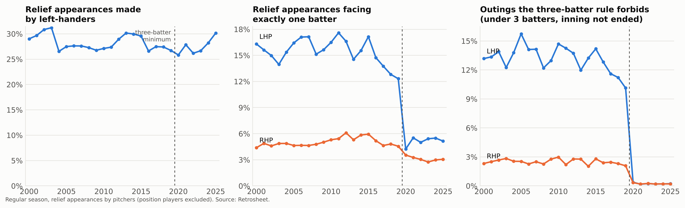
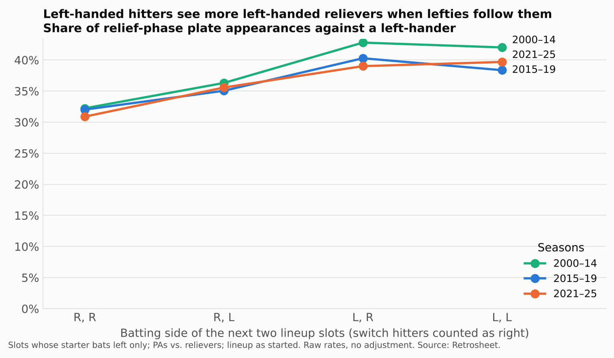
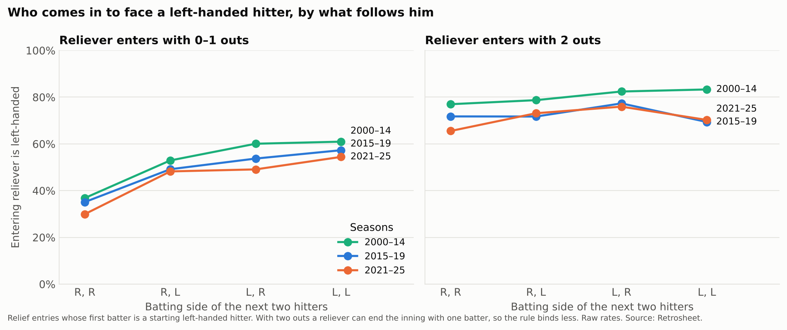
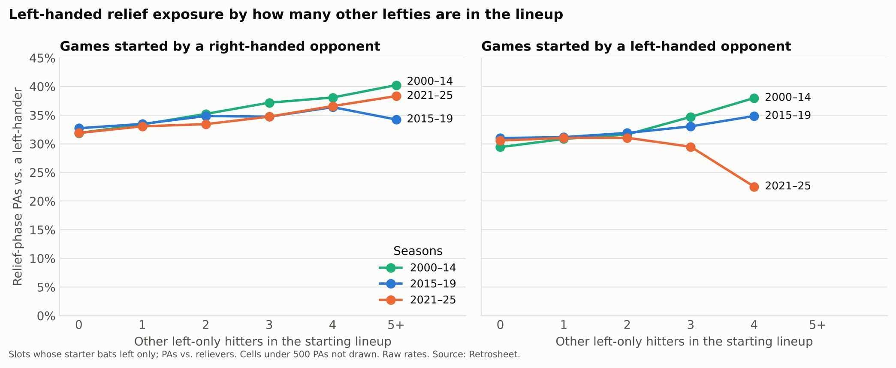
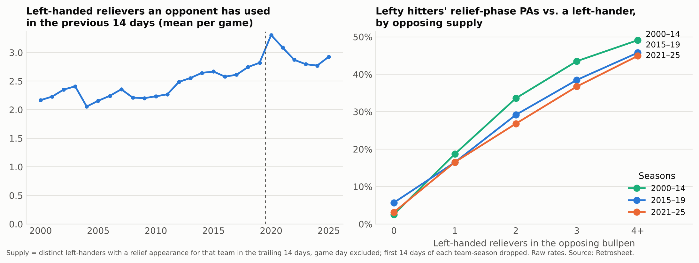
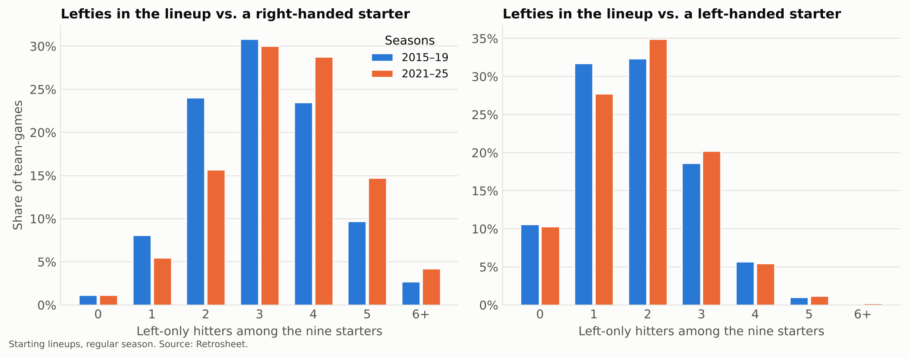
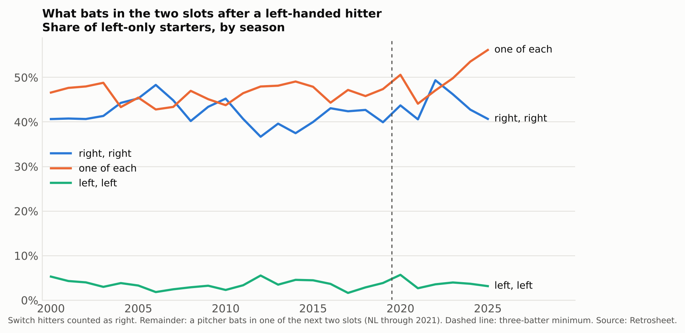

# Phase 2 — descriptive findings

Status: **awaiting review. No models have been fitted.** Everything here is a
count, a rate or a cross-tab. Rates are raw: not adjusted for batter, opponent,
inning, score or anything else. Standard errors quoted are naive binomial
errors that ignore clustering by game, so they understate uncertainty. Nothing
below is a causal estimate.

Every number comes from a table in `reports/tables/`, written by the script of
the same name in `scripts/`. Sample: regular seasons 2000–2025, 4,706,329
plate appearances, which match Retrosheet's own game logs exactly in every
team-season.

Terms: an "LHH slot" is a lineup slot whose starter bats left only (the slot
is followed even if he is pinch-hit for). "Relief-phase" means against any
pitcher other than the game's first. "RR" means the next two lineup slots both
bat right against a lefty (switch hitters count as right); "anyL" means at
least one of them bats left.

## 1. What the data say

### 1.1 The rule removed the one-batter lefty but not the lefty reliever

- Outings the rule forbids (under three batters, inning not ended) were
  10–16% of left-handed relief appearances through 2019 and 0.2% from 2021.
- One-batter outings by lefties fell from 12–18% to about 5%. That share was
  already falling from 2015 (17.2%) to 2019 (12.3%), so there is a pre-trend.
- Left-handers' share of relief appearances did not fall: 26–30% throughout,
  30.1% in 2025.
- LHH relief-phase exposure to lefties barely moved: 34.2% of PAs in 2015–19,
  34.1% in 2021–25 (`tab01`). Over the same span lefties' share of *all*
  relief-phase PAs rose from 25.4% to 26.8%. So lefty hitters are still
  targeted, slightly less selectively.

### 1.2 Neighbor handedness is strongly associated with who pitches to a lefty (H1)

| Era | RR | anyL | Gap (pp) |
|---|---|---|---|
| 2000–14 | 32.2% | 38.4% | 6.1 |
| 2015–19 | 32.0% | 36.5% | 4.5 |
| 2021–25 | 30.9% | 36.7% | 5.8 |

The gap is well above the 2 pp threshold set in DESIGN §3 and it was there
long before the rule. That contradicts the story I told in DESIGN §5.2, that
before 2020 an isolated lefty could be picked off for free so neighbors
"barely mattered." They mattered, because most lefty relievers faced several
batters anyway (mean 3.8–4.6 batters per outing even in the specialist era).

### 1.3 The decision itself shows the same pattern, more sharply

When a reliever enters to face a starting LHH, he is a lefty 35% of the time
if two righties follow and 53% if a lefty follows (2021–25; `tab06`). This
conditions on a change being made, so it describes who comes in, not whether
anyone does.

### 1.4 Before/after the rule: the gap widened, mostly in mid-inning changes (H4)

Change in the anyL-minus-RR gap, 2015–19 to 2021–25 (`tab06_change_in_gap`):

| View | Cut | Gap before | Gap after | Change (pp) | Naive SE |
|---|---|---|---|---|---|
| PA | all | 4.5 | 5.8 | +1.3 | 0.4 |
| PA | 0–1 outs | 6.4 | 8.0 | +1.6 | 0.5 |
| PA | 2 outs | 0.8 | 1.3 | +0.5 | 0.7 |
| Entry | start of inning | 15.5 | 17.1 | +1.6 | 1.1 |
| Entry | mid-inning | 6.1 | 13.2 | +7.1 | 1.5 |
| Entry | mid-inning, 0–1 outs | 10.2 | 18.5 | +8.3 | 2.2 |
| Entry | mid-inning, 2 outs | 1.3 | 8.1 | +6.8 | 2.2 |

Three things to take from this:

1. The direction matches H4, and the change sits where the rule bites:
   mid-inning entries, the old specialist's territory. Inning-start entries
   hardly changed.
2. **The two-out test in DESIGN §5.2 does not look like it will work as
   designed.** I predicted the rule would bind far less with two outs. In
   mid-inning entries the gap widened about as much with two outs (+6.8) as
   with fewer (+8.3). By the falsification clause I wrote for H4, equal growth
   with two outs means "something other than the rule is driving it." The
   alternative is that my premise was too strong: with two outs the lefty is
   only released if he retires the batter, so the rule still binds about a
   third of the time. I can't separate those from raw rates. This needs your
   call before Phase 3 (§3 below).
3. 2000–14 had a gap as large as 2021–25 (6.1 vs 5.8 at PA level). A
   two-period comparison of 2015–19 vs 2021–25 could be picking up recovery
   from an unusually low 2015–19, not the rule. The event-study by season in
   Phase 3 has to show a break at 2020, not just a difference in means.

### 1.5 Count of lefties: no sign of it mattering once arrangement is fixed (H2)

Pooled, exposure rises with the number of other lefties in the lineup against
right-handed starters. But holding the next-two configuration at RR, it is
flat: 32–33% in 2015–19 and 31–32% in 2021–25 for zero through four other
lefties (`fig06_exposure_by_lefty_count_within_cfg`). The pooled slope looks
like composition: more lefties means more lefties adjacent to each other.
Neither the "protection by count" story nor my "dilution" counter-story shows
up. Raw data favor "arrangement matters, count does not."

### 1.6 Opposing bullpen supply is the strongest pattern in the data (H5)

LHH relief-phase exposure to lefties in 2021–25: 3% when the opponent has
used no lefty reliever in the prior 14 days, 17% with one, 27% with two, 37%
with three, 45% with four or more. The neighbor gap (RR vs LL) is about 1 pp
in the zero-supply cell and 3–11 pp elsewhere — what the negative control
predicts, though the zero-supply cell is tiny (46 LL-configuration PAs in
2021–25). The 3% is not zero because the supply measure misses call-ups and
pitchers returning from more than 14 days off.

Supply swamps arrangement: going from a two-lefty to a three-lefty opposing
bullpen moves exposure by 10 pp, about twice the neighbor gap.

### 1.7 The effect runs both ways (H6)

Right-handed hitters' relief-phase exposure to lefties, by who bats
immediately before them (`tab04`):

| Era | Righty before | Lefty before | Gap (pp) |
|---|---|---|---|
| 2015–19 | 16.3–18.1% | 22.8–25.1% | ~6 |
| 2021–25 | 18.6–20.3% | 25.2–29.1% | ~7 |

Righties batting behind lefties get more platoon-advantaged PAs. The raw data
support the objection in DESIGN §1.4: this is a property of the mix, and
crediting it to "the righties" double-counts.

### 1.8 Pinch-hitting for lefties jumped after 2020 (channel C3)

Share of LHH-slot relief-phase PAs taken by someone other than the starter
(`tab03`):

| Era | vs LHP | vs RHP |
|---|---|---|
| 2015–19 | 9.4% | 6.7% |
| 2021–25 | 15.4% | 6.7% |

Almost all of the increase is a right-handed batter coming in. A lefty who
must stay for three batters is a better target for a pinch hitter. This was
not in my hypotheses. It means (a) the bench is a bigger part of the story
than DESIGN §1.5 allowed, and (b) following the *player* instead of the
*slot* would understate what happens in his lineup position by a growing
amount. The universal DH (2022) and the 26-man roster are confounds here.

### 1.9 How teams build lineups

- Against right-handed starters the average lineup had 3.08 left-only hitters
  in 2015–19 and 3.41 in 2021–25; against lefties, 1.8 in both.
- Teams already avoid stacking: only 3–5% of lefties have two lefties behind
  them. That is why the LL cells are small and why I pool to "anyL."
- Since 2022 "one of each" has risen and RR has fallen, i.e. lineups are
  getting more alternated, not just more left-handed.

### 1.10 Starter alignment (H7)

Team-seasons with a larger share of PAs by left-only hitters face somewhat
more left-handed starters: within-season correlation 0.19 (2015–19) and 0.26
(2021–25) (`fig07`). Division and schedule are not accounted for, so this is
an association to be explained, not evidence of opponents re-aligning
rotations.

## 2. Priors replaced

| Quantity | Phase 1 prior | Measured (2021–25) | Source |
|---|---|---|---|
| PAs per season | ~185k | 182–184k | `tab01` |
| Share of PAs in LHH slots | ~40% | 33% (the prior wrongly included switch hitters) | `tab01` |
| Relief-phase share of those | ~40% | 42% | `tab01` |
| LHH relief-phase PAs per five-year era | ~150k | 127k (108k in 2015–19) | `tab01` |
| LHH platoon split, wOBA | 25–30 points | 30 points overall, 35 vs relievers | `tab02` |
| "Specialist" split | 40–50 points | not measured; needs pitcher-level talent estimates (Phase 3) | — |
| RHH platoon split | smaller | 17 points overall, 19 vs relievers | `tab02` |

Linear weights and wOBA scale are derived in-repo from run expectancy
(`weights.parquet`); league wOBA equals league OBP by construction.

## 3. What this means for the design — decisions needed

**3.1 The effect on deployment is real; its run value looks smaller than the
threshold we set.** Plain arithmetic on raw numbers
(`tab06_implied_magnitude`): a 5.8 pp exposure gap × a 35-point split × 42%
of PAs in the relief phase ≈ 0.0008 wOBA, or **about 0.4 runs per lefty per
600 PA** (0.24 in 2015–19). The threshold in DESIGN §3 is 1 run. This
arithmetic ignores pitcher quality beyond handedness, which is the reason E2
exists, and it is confounded. But quality would need to more than double the
effect to reach the threshold. The likely Phase 3 result is the one DESIGN §3
lists as falsifying H1 on value: "exposure changes but it does not matter."
You should decide now whether that is still the project you want to finish,
or whether the framing should shift toward what the descriptives say is
bigger (3.3).

**3.2 The H4 identification needs repair.** The two-out contrast is weaker
than I claimed (§1.4). Options: (a) keep it as pre-specified and accept it
may fail; (b) replace it with a mid-inning vs. inning-start contrast, which
the raw data favor — but choosing it *after* seeing the data makes it
exploratory, and it must be labeled that way; (c) run both, with (a) as the
pre-specified test and (b) as exploratory. I recommend (c).

**3.3 Two things look larger than the neighbor effect and were not
hypotheses:** opposing bullpen supply (§1.6) and the post-2020 pinch-hitting
response (§1.8). A front office can act on both: the first says lineup
balance matters more against lefty-deep bullpens, the second says a
right-handed bench bat gained value under the rule. Promoting either to a
hypothesis is a change to the pre-specified design and is yours to approve.

**3.4 Pool LL into "anyL."** LL configurations are 3–5% of lefties. I
recommend the primary neighbor contrast be RR vs anyL, with the four-way
split reported as secondary. Same caveat: this is a post-data change.

**3.5 Opener threshold.** Starts of under 10 batters were below 1% through
2015 and 3–5% from 2018 (`tab05`). I propose treating a starter who faces
fewer than 10 batters as an opener for H7 only. No effect on the main
analysis.

## 4. Literature search (pulled forward)

Searched before building. **Limitation: this environment's network policy
blocks the article hosts, so I could read search summaries only, not full
text.** Treat the characterizations below as unverified against the sources.

- I found no published estimate of how the handedness of adjacent hitters
  changes a lefty's exposure to left-handed relievers, or of its run value.
  "Not found in a summaries-only search" is weak evidence of absence.
- FanGraphs, ["The Three Batter Minimum's Effect on Late-Game Strategy"](https://blogs.fangraphs.com/the-three-batter-minimums-effect-on-late-game-strategy/):
  reported late-game lefty usage down about 1.2 pp after the rule, mostly
  from fewer lefty relievers and not from more pinch-hitting. That was early
  data; our 2021–25 pinch-hitting numbers (§1.8) point the other way.
- FanGraphs (Ben Clemens, Dec 2019), ["The Three Batter Minimum Rule Barely Matters"](https://blogs.fangraphs.com/the-three-batter-minimum-barely-matters/):
  an upper-bound argument that the rule's effect on team outcomes is small.
  Consistent with §3.1.
- FanGraphs Community, ["A Lineup Construction Experiment"](https://community.fangraphs.com/a-lineup-construction-experiment/):
  argues for batting a lefty-masher behind a left-handed star under the rule.
  The same mechanism as H1, by example and not estimated.
- Bradbury & Drinen, ["Pigou at the Plate"](https://ideas.repec.org/a/sae/jospec/v9y2008i2p211-224.html),
  *Journal of Sports Economics* 9(2), 2008, 211–224: citation confirmed.
  Finds on-deck hitter quality has a very small, negative effect on the
  batter ahead. Quality, not handedness.
- Papps & Bryson, ["Spillovers and Substitutability in Production"](https://econpapers.repec.org/RePEc:iza:izadps:dp12252),
  IZA DP 12252, 2019: uses the fixed batting order to estimate teammate
  spillovers at the PA level. Whether handedness enters, I could not check.
- Gould & Winter, *Review of Economics and Statistics*, 2009: teammate
  spillovers from panel data, 1970–2003. Season-level, not lineup-level.
- *The Book* (Tango, Lichtman, Dolphin): advises against batting consecutive
  lefties. I could not retrieve its quantified reasoning.

## 5. Known limitations of the Phase 2 tables

- "Current occupant" of a neighbor slot is the last batter seen there; a
  defensive substitute who has not yet batted is missed. It agrees with the
  started lineup on 98.4% of PAs.
- Bullpen supply counts distinct relievers used in the trailing 14 days. It
  misses fresh call-ups, counts pitchers since optioned or injured, and rises
  mechanically with roster churn, so the upward trend in "supply" (2.2 to
  2.9 lefties) partly reflects more arms cycling through.
- A starting pitcher with at least 150 PA in a season is typed as a hitter
  (two-way players); other pitchers batting are type P.
- Statcast is not yet in the pipeline. The Baseball Savant host is blocked in
  this environment; it is only needed for the xwOBA check in Phase 3.
- The `talent` table (DESIGN §4.3 item 5) was not built. Shrunken talent
  estimates are a model, and the gate says no models before review.
